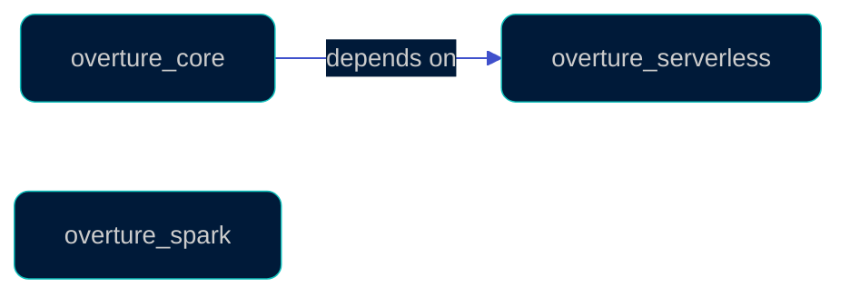

[](https://github.com/OvertureMaps/overture-core/actions/workflows/test_python.yml)
[](https://github.com/OvertureMaps/overture-core/actions/workflows/lint.yml)
[](.python-version)
[](https://docs.astral.sh/uv/)
[](https://docs.astral.sh/ruff/)
[](LICENSE)

Shared Python libraries for the Overture data platform: portable job classes and framework-agnostic helpers for cloud, SQL, STAC and third-party APIs.

A monorepo of independently versioned, independently published packages. Each directory under [`packages/`](packages) with a `pyproject.toml` and a `tests/` directory is one package.

## Packages

| Package | Description | PyPI |
| --- | --- | --- |
| [`overture_core`](packages/overture_core) | Shared, framework-agnostic business logic: helpers and portable job classes. | [](https://pypi.org/project/overture-core/) |
| [`overture_serverless`](packages/overture_serverless) | Base classes for portable, framework-agnostic serverless jobs. | [](https://pypi.org/project/overture-serverless/) |
| [`overture_spark`](packages/overture_spark) | Portable, framework-agnostic Spark job runtime helpers. | [](https://pypi.org/project/overture-spark/) |



## What lives here (and what doesn't)

Libraries only: code that runs the same under Airflow, ECS, Glue, Databricks or a laptop. Each package is published to PyPI and consumed as a pinned version.

Does **not** belong here:

- DAGs, schedules and cloud topology: those live in the orchestration repo, `overture-pipelines`.
- Infrastructure as code and deployment config.
- Anything consumed via a git ref. Downstream consumption is published packages only.

## CI

- **PR:** [Test Python](.github/workflows/test_python.yml) and [Lint](.github/workflows/lint.yml) cover every package that matches the shape above; no workflow edits are needed when one is added. [SQL Engines](.github/workflows/sql_engines.yml) runs the Spark/Trino suites, and [MWAA Compatibility](.github/workflows/mwaa_compat.yml) checks that `overture_core` still installs under MWAA's pinned constraints.
- **Merge to main:** [Publish Python Packages](.github/workflows/publish_packages.yml) releases each changed package. PR titles must be Conventional Commits because PRs are squash-merged and the title decides the version bump.

## Local development

Requires [uv](https://docs.astral.sh/uv/) and Python 3.11+.

```sh
cd packages/overture_core
uv sync --extra dev
uv run pytest
```

## Contributing

See [`CONTRIBUTING.md`](CONTRIBUTING.md) for how to add a package, wire up cross-package dependencies, and run tests/lint locally. See [`PACKAGE_VERSIONING.md`](PACKAGE_VERSIONING.md) for how a version bump turns into a PyPI release.
