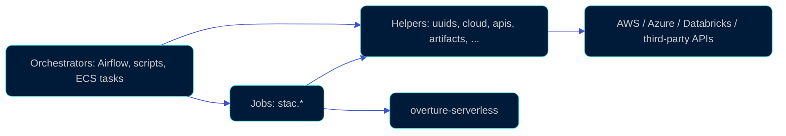

# overture_core

[](https://pypi.org/project/overture-core/)
[](https://pypi.org/project/overture-core/)
[](https://docs.astral.sh/uv/)
[](LICENSE)

Shared, framework-agnostic business logic for the Overture data platform: helpers and portable job classes built on [`overture-serverless`](../overture_serverless).

Everything here runs anywhere Python does (Airflow, ECS, Glue, Databricks, a laptop). Orchestration, DAGs and cloud topology live elsewhere.

## Install

```sh
uv add overture-core
uv add 'overture-core[stac]'  # with an extra
```

Heavier dependencies are optional extras, so consumers on constrained runtimes (for example MWAA's pinned `pyarrow`) stay installable. Quote the extra in shells like zsh that glob brackets. `uv pip install overture-core` works for environments not managed by a uv project.

For local development, run `uv sync --extra dev` in this directory, then `uv run pytest`.

| Extra | Adds | Needed for |
| --- | --- | --- |
| *(none)* | `boto3`, `PyGithub`, `pystac`, `sqlglot`, ... | `cloud` (AWS), `iceberg`, `versioning`, `uuids`, `uuids_sql`, `spark_sql`, `strings_sql`, `apis.tomtom`, `apis.github`, `stac.latest_release_job.LatestRelease` (read-only over HTTPS) |
| `stac` | `overture-stac` (`pyarrow>=16` via `stac-geoparquet`) | `stac.job.PublishStac`, `stac.catalog.build_release_catalog` |
| `azure` | `azure-storage-blob` | `cloud.azure` |
| `maproulette` | `maproulette`, `geojson`, `shapely` | `apis.maproulette.MapRouletteClient` |
| `sql-spark` / `sql-trino` | `pyspark` / `trino` | Running the SQL-engine test lanes; not needed to use the SQL-string helpers |

`cloud.aws.object.read_parquet_prefix` needs a `pyarrow` of your choosing on the path.

## Quick start

Mint a GitHub App installation token outside a GitHub Actions step, with the PEM read from Secrets Manager:

```python
from overture_core.apis.github import get_github_client, get_installation_token

token = get_installation_token("my/app-pem-secret", app_id=123456, installation_id=7890123)
gh = get_github_client("my/app-pem-secret", app_id=123456, installation_id=7890123)
```

Failures raise `GitHubAppTokenError` without the PEM or token in the message. See the [reference doc](https://github.com/OvertureMaps/omf-github-terraform/blob/main/docs/github-app-tokens.md).

## What lives here (and what doesn't)

Helpers are importable on their own; jobs compose them behind a `run()` entry point.



Does **not** belong here:

- DAGs, schedules or cloud topology: those live in `overture-pipelines`.
- Reusable Airflow constructs (operators, sensors, task groups): those live in `overture-airflow`.
- Infrastructure as code or container definitions.

Optional provider SDKs stay out of the base dependencies: add an extra and import the SDK lazily inside the helper.

## Structure

```
overture_core/
├── apis/           # third-party HTTP API clients (tomtom, maproulette, github)
├── cloud/          # provider-agnostic code + aws/, azure/, databricks
├── dataset/        # dataset configs, license policy, overture-datasets CLI
├── stac/           # STAC catalog reads/writes and publish jobs
└── *.py            # standalone helpers (uuids, bbox, iceberg, versioning, ...)
tests/              # mirrors overture_core/; SQL-engine tests need extras (see CI)
```

## Modules

Framework-agnostic helpers, each importable on its own without pulling in the job classes below.

<!--
When adding or editing a row: describe the module's scope/boundary (what kind of
helper belongs here), not an inventory of its current classes/functions. This
table should stay accurate as the module grows without needing an edit every
time something is added to it. Put new code in the module whose scope already
covers it; only add a new row/module when nothing existing fits.
-->

| Module | Scope |
| --- | --- |
| `uuids` | Pure Python, Spark-free UUID generation for any UUID version, current or future RFC. |
| `uuids_sql` | SQL-string equivalents of `uuids`, for computing UUID columns server-side in Spark or Trino instead of round-tripping through a Python UDF. |
| `spark_sql` | Spark SQL table-creation strings from caller-owned column definitions, rendered with SQLGlot without importing Spark or Arrow. |
| `strings_sql` | SQL expressions that make string values satisfy the Overture schema's string constraints (e.g. `StrippedString`), computed in-query instead of through a Python UDF. |
| `versioning` | Deriving a consistent dated version string for sources that don't publish explicit version metadata. |
| `iceberg` | Shared Iceberg + Sedona catalog configuration, reusable across platforms/engines. |
| [`cloud`](overture_core/cloud/README.md) | Cloud helpers: provider-agnostic code plus one subpackage per vendor (`aws`, `azure`, `databricks`). |
| `pypi` | Provider-agnostic PyPI package download/publish helpers, usable against any index. |
| `apis` | Clients for third-party HTTP APIs, one module per vendor (`apis.tomtom` for TomTom's Map Content API, `apis.maproulette` for MapRoulette's project/challenge API — the latter needs `overture-core[maproulette]`). `apis.github` mints GitHub App installation tokens (PEM read from Secrets Manager; see the [reference doc](https://github.com/OvertureMaps/omf-github-terraform/blob/main/docs/github-app-tokens.md)) via `get_installation_token`, `get_installation_auth` and `get_github_client`. Anything that's not a cloud platform but still an external service belongs here. |
| `urls` | Generic URL string utilities not tied to any specific service or cloud provider. |
| `bbox` | Validating and safely rendering an optional bounding-box string param ("min_lon,min_lat,max_lon,max_lat", `''` = full planet), shared by any entry point that accepts one. |
| `stac` | STAC catalog reads/writes and the jobs that publish them (see [Jobs](#jobs)). |
| `data` | Describing a data location and its sync configuration, independent of the mechanism used to move it. |
| `docs` | Automating docs-repo updates for a release, via a GitHub App. |
| `artifacts` | Release artifact types (metadata, license, attribution) and the tree-search/S3 I/O to read and write them. |
| [`dataset`](overture_core/dataset/README.md) | Parsing, validating and rendering provider/resource dataset configs and the license policy, plus the `overture-datasets` CLI. |

## Jobs

- **`stac.job.PublishStac`**: publishes the Overture STAC catalog. Two modes selected by the presence of the `release` param:
  - *single-release* (`release` + `source_path` + `scratch_bucket`): publish just that release, mirror scoped to `stac/{release}/`. Schema comes from the RC bundle's `metadata.json`.
  - *walk* (no `release`, requires `scratch_bucket`): rebuild the catalog for every release currently in the public bucket, mirror the whole `stac/` prefix with delete-orphans. Schema per release comes from the existing STAC (`schema:version` in each `catalog.json`); on cache miss the job self-heals by reading schema from the released RC bundle in `scratch_bucket` and raises if it can't recover.
- **`stac.latest_release_job.LatestRelease`**: reads the STAC root catalog (`root_href`, defaults to the prod root) and resolves the newest release ID. Read-only, HTTPS-only, no AWS credentials or S3 access needed. Stashes the result on `self.latest_release` for a caller that instantiates the job directly instead of going through `run()`.

## Future work

- **Bundle-owned schema accessor** — when `ReleaseCandidateBundle` becomes publishable, move `read_schema_version_from_rc_bundle` onto it as `resolved_schema_version()`; single-release mode's schema read shrinks to one line.
- **Upstream `build_release_catalog`** — file a PR against [OvertureMaps/stac](https://github.com/OvertureMaps/stac) exposing this as a public API (their CLI already does the exact call sequence). When it lands, our wrapper collapses.
